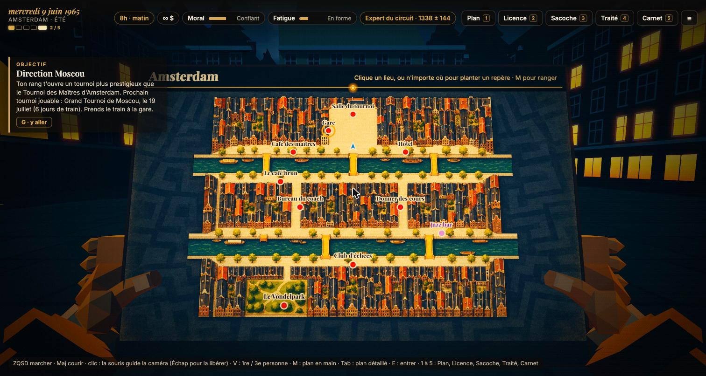
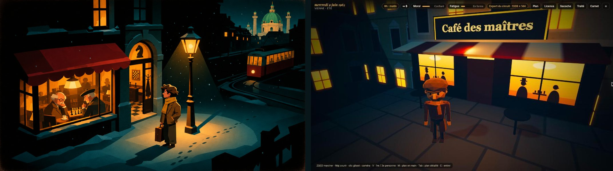
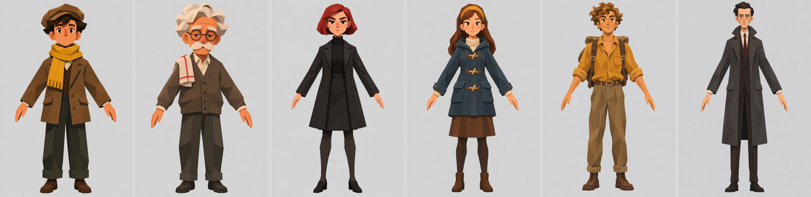

# The Chess Journey

**A chess career in 1965 Europe.** You arrive in Vienna with a suitcase and a few coins, and you travel city by city to Paris, Amsterdam and finally Moscow, playing Swiss-system tournaments, paying your hotel nights, hiring a coach, learning on the road and building your own opening.

> This repository is a showcase. The game is in development and its source code is private for now.

## The game

- **Walk through 3D cities** (Vienna, Paris, Amsterdam, Moscow): tournament hall, hotel, masters' café, club, park, coach's office, train station. The crowd grows with your rank and your name ends up on the tournament poster.
- **Play real chess** in 2D or in first person (your hand moves the pieces, the opponent reacts across the table), against bots with their own style and opening books, powered by Stockfish 16.
- **Live a career**: real calendar starting March 1, 1965, money, morale, fatigue, a coach's monthly salary, invitation-only tournaments, a rival who keeps crossing your path.
- **Honest progression**: Glicko-2 rating with its margin of error, ranks based on *your* progress since your starting level, lessons validated by Stockfish at full strength, 1,885 Lichess puzzles at your level.
- **The Treatise**: a leather notebook that fills up with the principles, tactics, endgames and openings you actually met during your games, and lets you replay your mistakes.

| | |
|---|---|
|  |  |

## Art direction

I direct the art: concept images first, then the 3D game is tuned to match them (light, amount of black, warm windows in cold streets).

## Under the hood

About 14,000 lines of JavaScript, no framework:

- **Three.js** for the cities, characters and the first-person board
- **Stockfish 16 (WebAssembly)** for the bots, the game analysis and the lesson checks
- **chess.js** for the rules, a custom 2D board (drag, premoves, arrows)
- **Glicko-2** rating, Swiss pairings, a career engine with a real calendar
- **Lichess OAuth (PKCE)** to compare with your online rating, no server needed
- Bot behaviour checked by simulation: hundreds of bot-vs-bot games to calibrate each opponent

Built with Claude Code as a pair programmer: I design the game, the systems and the art direction, and we build it together.

## Credits

Stockfish (GPL-3), chess.js (BSD-2), Three.js (MIT), cburnett pieces, Lichess puzzles (CC0), 3D assets by Quaternius and Kenney (CC0).

© 2026 Roman M'Barali. All rights reserved.
