# The Chess Journey

**A chess career in 1965 Europe.** You arrive in Vienna with a suitcase and 250 dollars, and you travel city by city through Munich, Paris and Amsterdam to Moscow, playing Swiss-system tournaments, paying your hotel nights, hiring a coach and learning on the road. The goal is simple: get better at chess without feeling like you are in school.

> This repository is a showcase. The game is in development and its source code is private for now.

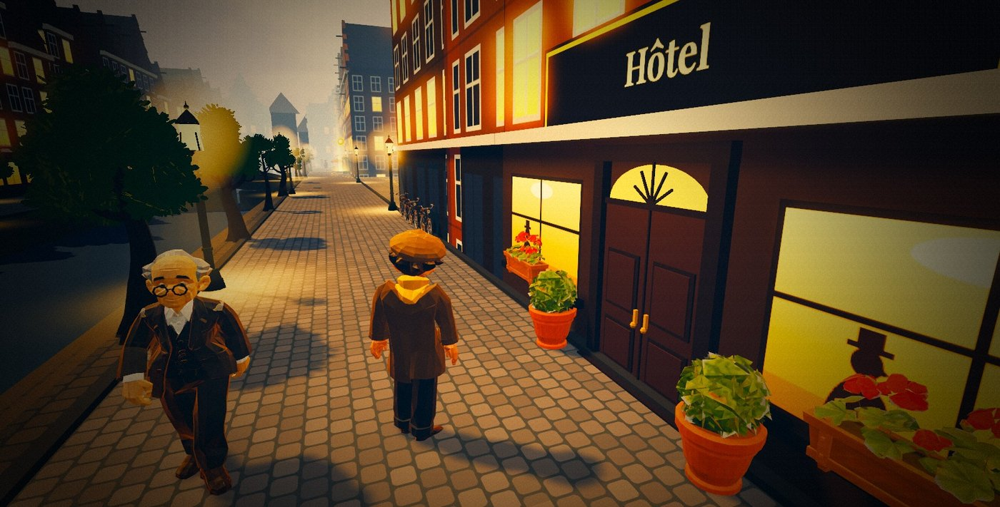

## The game

- **Walk through 3D cities** (Vienna, Munich, Paris, Amsterdam, Moscow, and small towns along the railway): tournament hall, hotel, masters' café, club, park, coach's office, train station, newspaper kiosk, taxi stand. A city opens only when you have finished the previous one, and an objective on screen always tells you what to do next.
- **Play real chess** in 2D or in first person (your hand moves the pieces, the opponent sits across the table and reacts), against bots that play like humans of their level, with 8 playing styles, 50 recurring circuit players and their own opening repertoires. Powered by Stockfish 16.
- **Play real people**: link your Lichess account, and the street player in the park or any passer-by you talk to can start a real online game, inside the game's own board.
- **Learn by playing**: the Treatise, a leather book of 71 chess notions that fills up with what you actually met in your games. Every lesson and every chess book you buy opens as a short cinematic: the book slides onto the desk, the title is written with a quill, then the pieces move by themselves before you get your exercises.
- **Honest progression**: Glicko-2 rating with its margin of error, ranks based on *your* progress since your starting level (the circuit ends when you win in Moscow and have gained 600 points), a move-by-move game review, 5,049 Lichess puzzles matched to your level.
- **A world with faces**: Meshy 3D characters and passers-by, each with a painted portrait when you talk to them. Every dialogue is written on a torn notebook page pinned to the screen.
- **A piano in the café**: a small rhythm game on the upright piano of the Vienna café (Satie, Strauss, Joplin), played on real piano samples.
- **Light on the player**: no fatigue, no forced sleep, money never blocks you (there is always a free freight train). It runs offline once loaded, can be installed like an app, and phones and tablets get a 2D mode and touch controls, although it plays best on a computer.

| | |
|---|---|
| 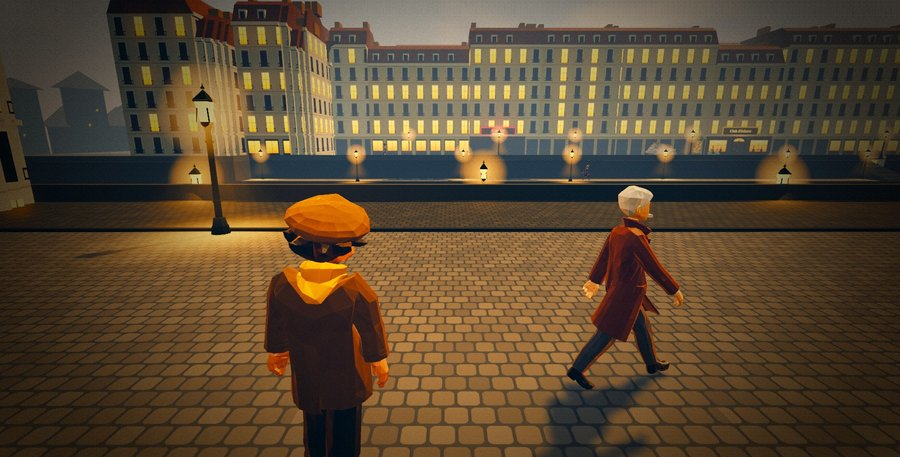 | 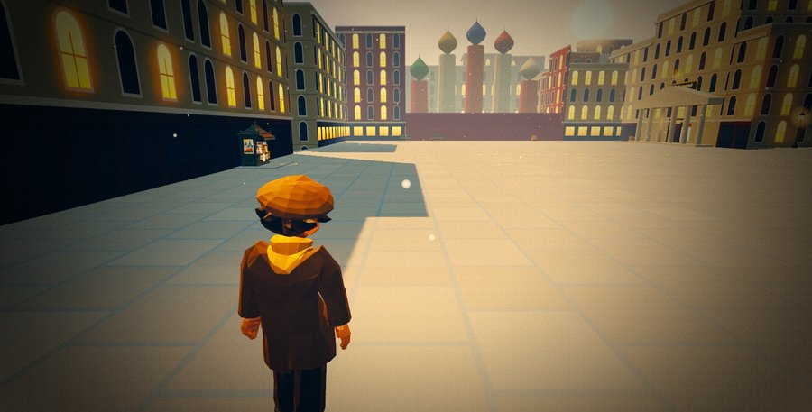 |

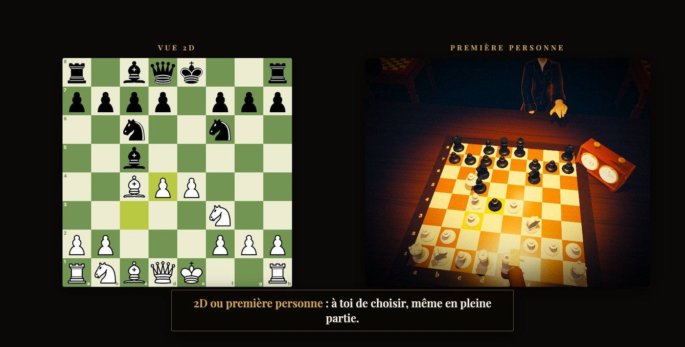

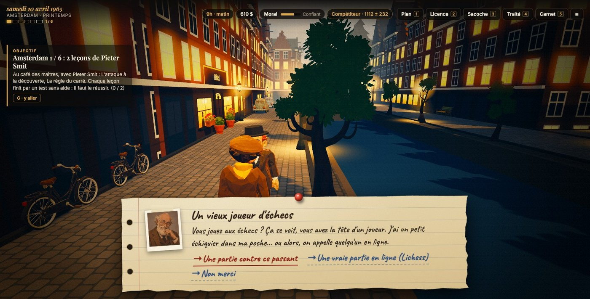

## Art direction

I direct the art. Every screen that felt like "a website made by an AI" was redone as an object or a painted scene from 1965: the pause menu is a café table, the inventory is a leather satchel, the Treatise is a bound book, the city map is a painted plan held in your hands.

| | |
|---|---|
| 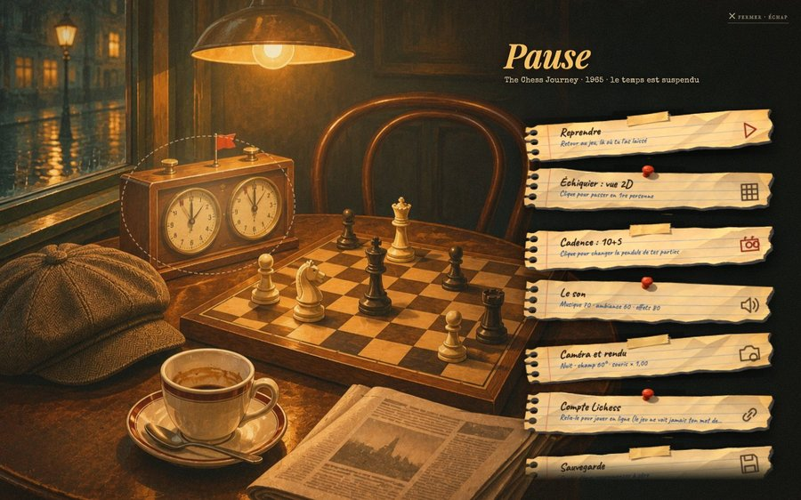 | 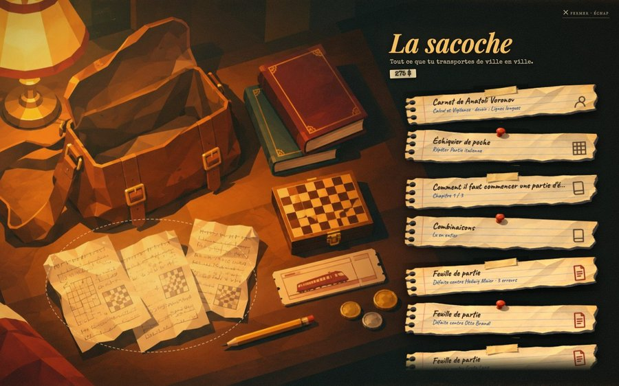 |
| 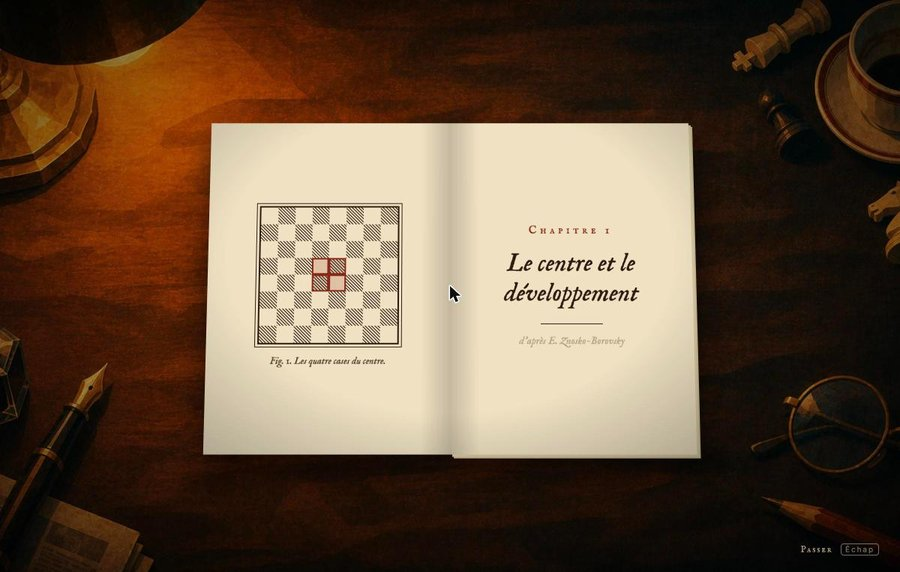 | 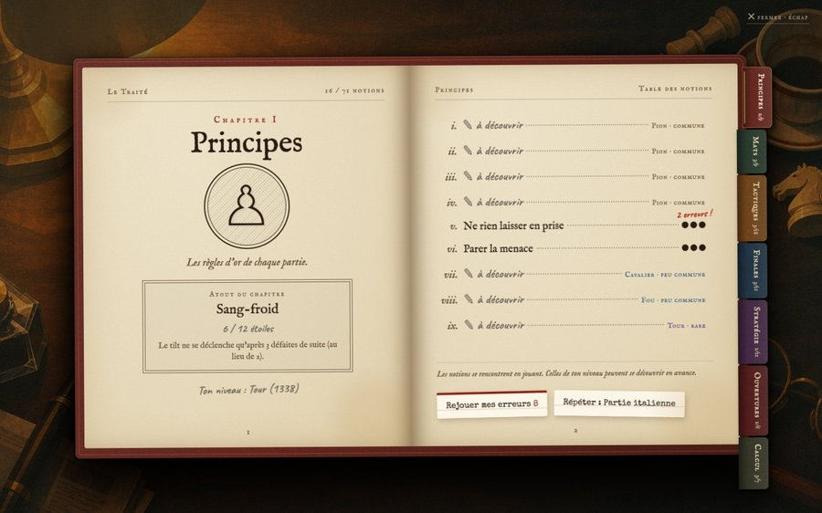 |

The 24 painted portraits of the passers-by. When you talk to someone in the street, the role they announce matches their face, and the same person keeps the same face.

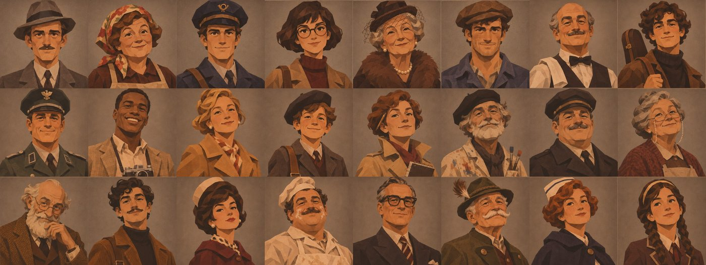

## How I made it

The game was built in about two weeks, from November 10 to November 24, 2026. I direct it: game design, art direction, pedagogy, and a lot of playtesting. The code is written by Claude Code, working as my pair programmer. Concept images, painted menus, maps and portraits come from ChatGPT, and the 3D characters and props from Meshy. Everything is written down in a project log of more than 100 entries: what was built, what I decided and why, and what we threw away.

**How it went**

- **Day 1**: five game concepts. I picked a Pokémon-like adventure, then changed everything the same day for a realistic career inspired by *The Queen's Gambit*: Vienna to Moscow, 1965, a first-person board with a hand that moves the pieces.
- **Days 2 and 3**: cities you can walk in, the Treatise, the bots, the art direction, Lichess. The first real online game I played from inside the game is when it stopped being a prototype for me.
- **Second week**: the Meshy campaign (38 props and 18 characters), a full pedagogical audit, painted menus, book cinematics, faces for the passers-by, then getting it ready to put online: saves that cannot be lost, offline play, a download cut from about 500 MB to 93 MB.
- **Last day**: more light. The game was a night city; I asked for "almost daytime, around 5 pm", and it is now late afternoon.

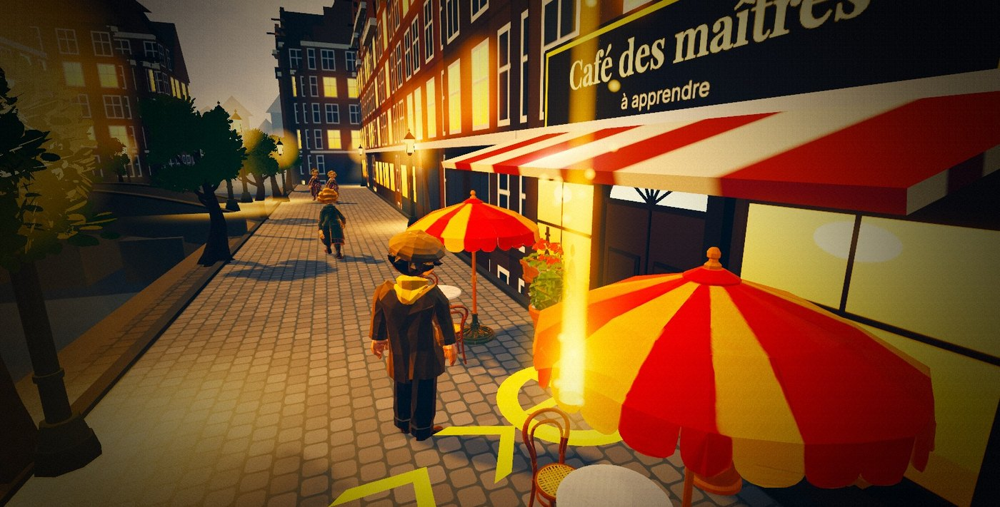

**The method**

- **Concept images first, then the 3D is tuned to match.** I chose a style from a form of 15 indie styles, then three test images, then a second form to set the amount of black, the faces and the palette. The game was then adjusted to the images, not the other way round.
- **Characters: from code to Meshy.** The first characters were built in code. My honest rating was 4/10. So each character was drawn by ChatGPT (front, side, back), turned into 3D with Meshy image-to-3D, rigged and animated, then placed in the game. For the passers-by, a trick: six base models with the coat painted pure magenta and the hair pure green, and the game swaps those two colors at random. Six models, a whole city of different people.

- **Rules instead of case-by-case fixes.** Houses placed one by one kept leaving gaps and walls you could walk into. I asked for one rule for every building: the city is cut into 50 cm cells, and anything that is neither street nor water is solid. Gaps became impossible by construction.
- **Measure instead of guessing.** I lost to a bot rated 687 while playing at 85% accuracy: our "beginner" bots were playing like 1800 players. We measured with Stockfish, taught them real beginner blunders, then recalibrated them against my chess.com level. Hundreds of bot-vs-bot games and 300 simulated careers per player profile were used to check the bots, the money and the progression (one style turned out to play 200 points above its rating).
- **A pedagogical audit.** Every exercise must say its theme and its goal, and practice must be exactly what you just learned. Ten fixes came out of it: wrong lessons rewritten, 120 lesson questions checked with Stockfish, hand-written positions where Lichess has no puzzle, and no star without a real test. The audit even found mistakes in the old courses (an illegal position, a "winning" line that missed a mate in one).
- **Playtests and before/after comparisons.** I play, send screenshots, and say when something is bad, often. Every visual change is checked against a capture of the same place before and after, and test saves at 10, 30, 60 and 90% of the game let me jump to any point of the career.
- **Throwing things away.** The Pokémon world, weekly career slots, opening hours, a 1948 investigation storyline, a video-style game review with a voice-over, and finally the fatigue and sleep system: all removed because they were not fun.

## Under the hood

About 19,500 lines of JavaScript, no framework:

- **Three.js** for the cities, characters and the first-person board
- **Stockfish 16 (WebAssembly)** for the bots, the game analysis and the lesson checks
- **chess.js** for the rules, a custom 2D board (drag, premoves, arrows)
- **Glicko-2** rating, Swiss pairings, a career engine with a real calendar starting March 1, 1965
- **Lichess OAuth (PKCE) and Board API** for real online games, no server needed
- 3D models compressed with meshopt and WebP (220 MB down to 40 MB), a service worker for offline play
- Bot behaviour checked by simulation: hundreds of bot-vs-bot games to calibrate each opponent

## Credits

Stockfish (GPL-3), chess.js (BSD-2), Three.js and meshoptimizer (MIT), cburnett pieces (CC BY-SA 3.0), Lichess puzzles (CC0), Salamander Grand Piano by Alexander Holm (CC BY 3.0), 3D assets by Quaternius and Kenney (CC0), characters and props generated with Meshy, fonts under the SIL Open Font License.

© 2026 Roman M'Barali. All rights reserved.
